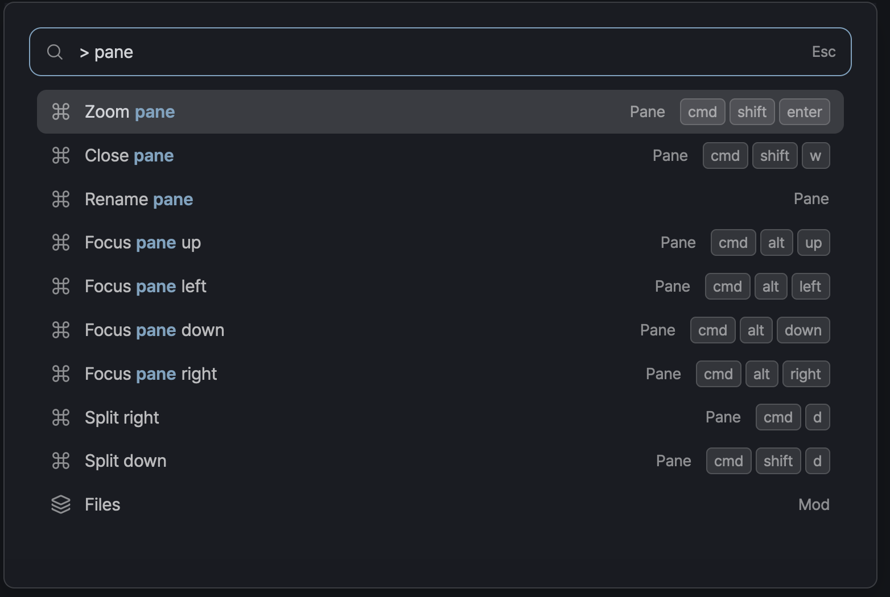
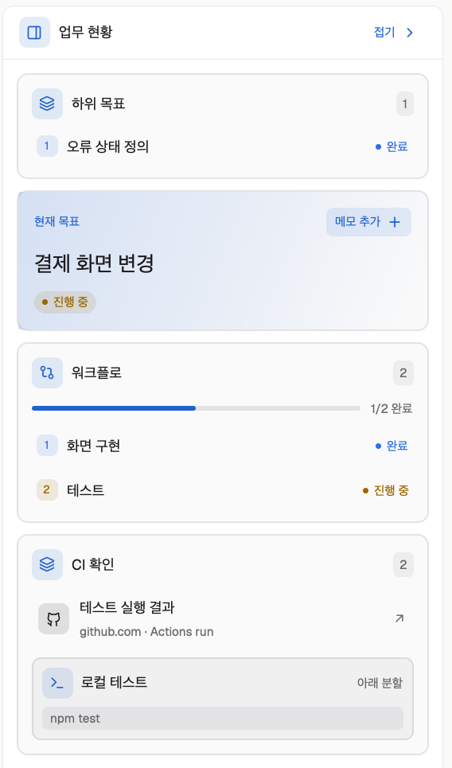

# herdr-kit

[Herdr](https://herdr.dev) 앱에서 쓰는 레이아웃과 mod 모음. 패키지마다 폴더 하나이고, 그 안은 herdr-app 홈(`~/.config/herdr-app`)과 같은 모양이다.

## Agent Dashboard

여러 스페이스의 에이전트를 응답 대기·완료·작업 중·유휴 상태별로 확인한다. 카드를 눌러 바로 응답하거나 세션으로 이동할 수 있다. 전체 현황은 탭에서, 현재 저장소 현황은 오른쪽 패널과 상태 줄에서 본다. [설정과 사용법](agent-dashboard/RECIPE.md)


## Kommand

탭과 에이전트로 이동하거나, Herdr 명령과 mod 기능을 한 팔레트에서 찾아 실행한다. `>`로 시작하면 명령만 검색하며, 등록된 단축키는 검색 결과 옆에 표시된다. [설정과 사용법](kommand/RECIPE.md)



## Workboard

에이전트가 발행한 목표, 진행 단계, 메모와 링크를 오른쪽 패널에서 확인한다. 기본은 탭별로 관리하고, 원하는 스페이스의 모든 탭이 같은 보드를 공유하도록 설정할 수 있다. 커맨드 카드를 누르면 현재 탭의 새 분할 터미널에서 실행되고, 패널을 접으면 하단 상태 줄에 목표와 진행률이 남는다. [설정과 사용법](workboard/RECIPE.md)



## 설치

**Herdr 안의 에이전트에게 맡기기.** "github.com/yoonhoGo/herdr-kit 의 agent-dashboard를 추가해줘"처럼 말하면, Herdr의 안내대로 `RECIPE.md`와 파일을 읽고 `mods/`(와 `layouts/`)를 홈에 복사한다.

**직접.**

```sh
git clone https://github.com/yoonhoGo/herdr-kit.git
cd herdr-kit
./install.sh                    # 모든 패키지
./install.sh agent-dashboard    # 고른 패키지만
```

`install.sh`는 `<패키지>/mods/*`를 `~/.config/herdr-app/mods/`로 복사하고(덮어씀), `<패키지>/layouts/*.json`은 같은 이름이 없을 때만 복사한다. 다른 홈은 `HERDR_APP_HOME=… ./install.sh`. 앱이 바로 다시 불러온다.

- **kommand**: `kommand/keys.json`(`cmd-k` → `mod.open:kommand`)을 내 `keys.json`에 합친다.
- **agent-dashboard**: 탭으로는 팔레트의 "Agent Dashboard: 새 탭으로 열기". 오른쪽 패널과 하단 상태 줄 요약은 레이아웃에 블록 두 개를 넣어야 한다([RECIPE의 Built from](agent-dashboard/RECIPE.md#built-from)). 넣은 뒤 "Agent Dashboard: 오른쪽 패널 여닫기"(`agent-dashboard.toggle`)로 여닫는다. 저장소 정보를 보이려고 스페이스 폴더에서 `git`/`jj`를 실행한다.
- **workboard**: 팔레트의 "Workboard: 업무 레이아웃 열기"로 전환한다. 기존 레이아웃을 계속 쓰려면 [패널·상태 줄 블록 두 개](workboard/RECIPE.md#built-from)를 추가한다. 설치 스크립트는 기존 레이아웃을 편집하지 않는다. [에이전트 스킬](workboard/skills/herdr-workboard/SKILL.md)을 읽힌 뒤 해당 탭에서 “지금 업무를 Herdr Workboard에 발행해 줘”라고 요청한다.

## 구조

```
<패키지>/
  RECIPE.md            처음부터 다시 만들 수 있는 설명서
  preview.png          미리보기
  mods/<이름>/          mod (main.js, mod.json, …)
  layouts/<이름>.json   레이아웃 패키지면
  skills/<이름>/       선택 설치하는 에이전트 스킬이 있으면
  keys.json            mod가 기대하는 키가 있으면
```

새 패키지는 이 모양으로 폴더를 하나 더 만든다. 레이아웃 패키지를 넣으면 레포 토픽에 `herdr-layout`도 단다(mod는 `herdr-mod`).

## 고치고 확인하기

```sh
./install.sh agent-dashboard
herdr-app check ~/.config/herdr-app/mods/agent-dashboard
node agent-dashboard/check.mjs          # 제목·시간·검색·레인 묶음·저장소 정보 규칙
```

미리보기는 실제 데이터 대신 가짜 데이터로 찍는다: `herdr-app do tab.new '{"mod":"agent-dashboard","props":{"demo":true}}'`.

## 라이선스

[MIT](LICENSE). kommand는 [herdr-bar](https://github.com/jeffarese/herdr-bar)(Jeff Arese, MIT)를 따라 herdr-app mod로 새로 만들었다.
