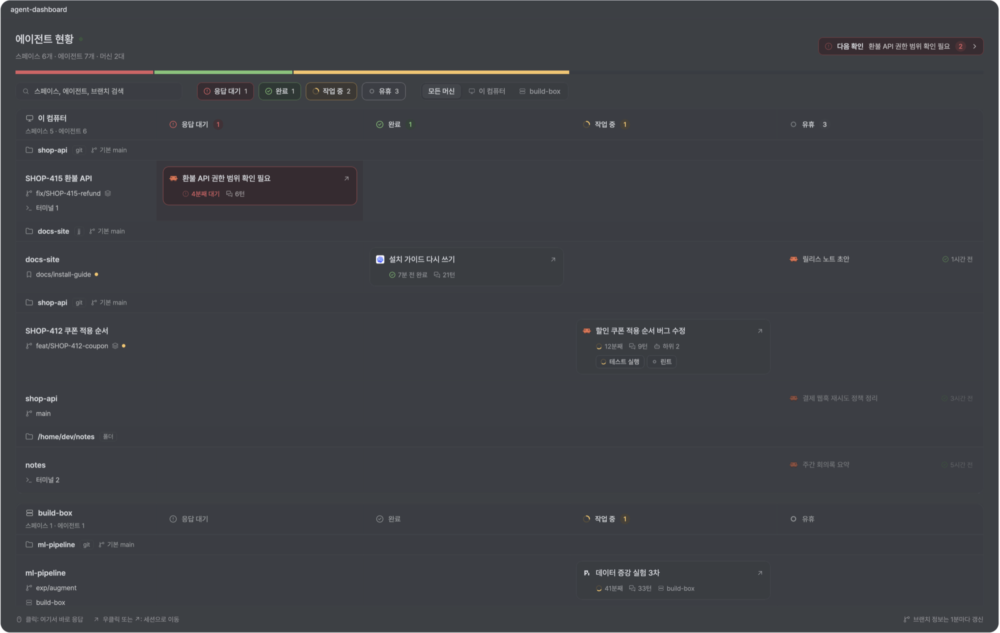

# herdr-kit

[Herdr](https://herdr.dev) 앱에서 쓰는 레이아웃과 mod 모음. 패키지마다 폴더 하나이고, 그 안은 herdr-app 홈(`~/.config/herdr-app`)과 같은 모양이다.

| 패키지 | 종류 | 무엇 |
|---|---|---|
| [agent-dashboard](agent-dashboard/RECIPE.md) | mod | 모든 에이전트를 상태 × 스페이스 매트릭스로. 오른쪽 패널(지금 저장소만)과 하단 상태 줄 요약, 클릭으로 바로 응답 |
| [bar](bar/RECIPE.md) | mod | 탭·에이전트 이동, 앱 명령, mod 기능, 키 동작을 한 목록에서 찾는 명령 팔레트 |



## 설치

**Herdr 안의 에이전트에게 맡기기.** "github.com/yoonhoGo/herdr-kit 의 agent-dashboard를 추가해줘"처럼 말하면, Herdr의 안내대로 `RECIPE.md`와 파일을 읽고 `mods/`(와 `layouts/`)를 홈에 복사한다.

**직접.**

```sh
git clone https://github.com/yoonhoGo/herdr-kit.git
cd herdr-kit
./install.sh                    # 모든 패키지
./install.sh agent-dashboard    # 고른 패키지만
```

`install.sh`는 `<패키지>/mods/*`를 `~/.config/herdr-app/mods/`로 복사하고(덮어씀), `<패키지>/layouts/*.json`은 같은 이름이 없을 때만 복사한다. 다른 홈은 `HERDR_APP_HOME=… ./install.sh`. 앱이 바로 다시 불러온다.

- **bar**: `bar/keys.json`(`cmd-k` → `mod.open:bar`)을 내 `keys.json`에 합친다.
- **agent-dashboard**: 탭으로는 팔레트의 "Agent Dashboard: 새 탭으로 열기". 오른쪽 패널과 하단 상태 줄 요약은 레이아웃에 블록 두 개를 넣어야 한다([RECIPE의 Built from](agent-dashboard/RECIPE.md#built-from)). 넣은 뒤 "Agent Dashboard: 오른쪽 패널 여닫기"(`agent-dashboard.toggle`)로 여닫는다. 저장소 정보를 보이려고 스페이스 폴더에서 `git`/`jj`를 실행한다.

## 구조

```
<패키지>/
  RECIPE.md            처음부터 다시 만들 수 있는 설명서
  preview.png          미리보기
  mods/<이름>/          mod (main.js, mod.json, …)
  layouts/<이름>.json   레이아웃 패키지면
  keys.json            mod가 기대하는 키가 있으면
```

새 패키지는 이 모양으로 폴더를 하나 더 만든다. 레이아웃 패키지를 넣으면 레포 토픽에 `herdr-layout`도 단다(mod는 `herdr-mod`).

## 고치고 확인하기

```sh
./install.sh agent-dashboard
herdr-app check ~/.config/herdr-app/mods/agent-dashboard
node agent-dashboard/check.mjs          # 제목·시간·검색·레인 묶음·저장소 정보 규칙
```

미리보기는 실제 데이터 대신 가짜 데이터로 찍는다: `herdr-app do tab.new '{"mod":"agent-dashboard","props":{"demo":true}}'`.
