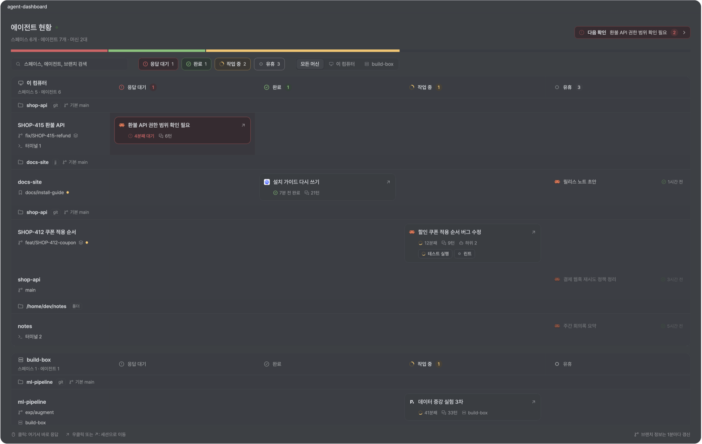

# Agent Dashboard

모든 스페이스의 코딩 에이전트(Claude Code, Codex, pi…)를 **상태 열(응답 대기·완료·작업 중·유휴) × 스페이스 레인** 매트릭스로 보는 대시보드. 머신마다 표가 따로 서고, 레인은 급한 순으로 정렬되며 같은 저장소(또는 경로)끼리 묶인다. 탭으로 열면 전체를, 레이아웃의 오른쪽 패널로 두면 지금 보고 있는 스페이스의 저장소만 보고, 접으면 하단 상태 줄에 요약이 남는다. 카드를 누르면 그 에이전트를 겹쳐 띄워 바로 답하거나 다음 채팅을 친다.



**What you see:**

- **머리(위)**: 제목 "에이전트 현황"(18px semibold)과 숨 쉬는 초록 점. 아래에 "스페이스 N개 · 에이전트 N개 · 머신 N대"(필터 중이면 "에이전트 N개 중 M개 표시 · 스페이스 K개"). 오른쪽에 "다음 확인" 버튼: 가장 오래 기다린 응답 대기(없으면 완료) 에이전트의 상태 색으로 옅게 칠하고(배경 13%, 테두리 40%) 상태 아이콘 · "다음 확인" · 제목 · 개수 pill · `>`. 없으면 초록 체크와 "확인할 것 없음".
- **상태 비율 막대**: 6px, 둥근 끝, 상태별 개수만큼 flex-grow(응답 대기·완료·작업 중은 테마의 상태 색, 유휴는 전경색 16%), 사이 간격 2px.
- **필터 줄**: 검색 입력(280px, 좁으면 200px·패널에선 한 줄 전체, 포커스 시 accent 테두리, 비어 있지 않으면 ✕) · 상태 칩 4개(아이콘·이름·개수, 켜지면 상태 색 배경 12%·테두리 45%, 0개면 상태 색 없이) · 머신 칩(모든 머신 / 이 컴퓨터 / 원격 머신 이름, 에이전트가 있는 머신이 둘 이상일 때만) · 필터가 걸려 있으면 오른쪽 끝 "필터 초기화".
- **머신마다 표**(둥근 12px 카드, 전경색 1.5% 바탕): 머리 줄 52px = 모서리 칸(모니터/서버 아이콘, 머신 이름, "스페이스 N · 에이전트 N" 또는 빨간 "연결 끊김") + 보이는 상태 열의 머리(아이콘·이름·개수 pill). 모든 머신에서 0개인 상태 열은 112px(좁은 폭 64px)로 줄고, 나머지가 폭을 나눈다.
- **묶음 머리** 34px: 저장소면 폴더 아이콘·저장소 이름·`git`/`jj` 배지·"기본 main", 저장소가 아니면 경로(`~/notes`)와 "폴더" 배지.
- **레인**: 왼쪽 머리 236px(좁은 폭 150px) = 스페이스 이름(13px semibold)과 칩들: 작업 브랜치(git 브랜치 아이콘) 또는 jj bookmark(책갈피 아이콘, 없으면 `@ 변경ID`) · 커밋 안 한 변경이면 작업 중 색 점 · 워크트리/workspace 이름(브랜치에서 온 이름이면 따로 줄 없이 브랜치 옆 레이어 아이콘, 툴팁) · 원격이면 머신 · 에이전트가 아닌 터미널이 있으면 "터미널 N"(툴팁 "zsh ×2, Neovim"). 저장소 정보를 묻는 중이면 깜빡이는 회색 막대.
- **카드**(응답 대기·완료·작업 중, 최대 480px, 둥근 10px, 외곽선): 첫 줄 = 에이전트 아이콘(14px) · 제목(13px medium, 줄바꿈) · 오른쪽 `↗` 버튼. 아랫줄(제목 아래로 들여씀) = 상태 아이콘과 시간("4분째 대기", "7분 전 완료", "12분째") · 💬 "N턴" · 하위 에이전트 수 · 원격 머신 · 제목과 다른 탭 이름. 하위 에이전트가 있으면 그 아래 칩(상태 아이콘·이름). 응답 대기 카드는 상태 색 배경 9%·테두리 55%, 응답 대기 칸 전체도 4.5%로 물든다. 60초 안에 상태가 바뀐 카드(작업 중 제외)는 accent 테두리.
- **유휴 항목**: 한 줄 28px = 에이전트 아이콘 · 제목(12px, muted, 말줄임) · 흐린 초록 체크와 "N시간 전". 3시간 넘게 쉰 것은 55% 불투명.
- **아래 안내 줄**: "클릭: 여기서 바로 응답 · 우클릭 또는 ↗: 세션으로 이동 · 브랜치 정보는 1분마다 갱신".
- **좁은 폭(오른쪽 패널, 디자인 폭 760px 미만)**: 상태 열이 없다. 머리는 제목과 접기 버튼 / 범위 칩과 요약 / 한 줄을 다 쓰는 "다음 확인"으로 쌓이고, 레인마다 이름과 칩이 한 줄로 흐른 뒤 카드(급한 순), 그 아래 유휴 항목. 머신 머리는 머신이 둘 이상이거나 원격일 때만.
- **하단 상태 줄 칸**(패널이 접혀 있을 때): 봇 아이콘 · 범위 이름(최대 150px) · 상태마다 아이콘과 개수 · "· 다음 <제목>" · 오른쪽 끝 패널 아이콘. hover 시 옅게 밝아진다.

**How it behaves:**

- **상태**: 응답 대기 = 경고 아이콘이 1400ms로 숨 쉼(opacity 0.4–1), 완료 = 초록 체크, 작업 중 = 도는 고리(900ms), 유휴 = 빈 고리(유휴 항목에서는 흐린 체크). herdr는 사람이 보면 완료를 유휴로 바꾼다.
- **시간**: 에이전트마다 지금 상태가 시작된 시각을 `localStorage`의 `changed`에 둔다(완료와 유휴는 한 단계). 처음 보는 에이전트는 탭의 `working_since`/`changed_at`을 쓰고, 모르면 가장 오래된 것으로 친다. 30초마다 다시 그려 시간을 갱신한다.
- **레인 순서**: 레인에서 가장 급한 보이는 상태(응답 대기 → 완료 → 작업 중 → 유휴) 순. 같은 단계에서는 묶음이 처음 나온 순서, 이어지는 같은 묶음은 머리 하나로 합친다. 단계가 갈리면 한 저장소가 두 번 나올 수 있다.
- **클릭**: 카드·유휴 항목·하위 칩·"다음 확인"을 누르면 `terminal.peek`(그 터미널을 겹쳐 띄워 답한다). 우클릭이나 `↗`는 `agent.focus`(그 세션으로 이동).
- **확인 큐와 Dock 배지**: 응답 대기(오래 기다린 순) 다음 완료. Dock 배지(`setBadge`)는 필터·범위와 상관없이 전체 개수.
- **필터**: 검색어 낱말을 모두 담아야 맞는다(대소문자 무시). 레인 필드(스페이스 이름·저장소·브랜치·워크트리·기본 브랜치·변경 ID·폴더·머신)와 에이전트 필드(제목·탭·프로그램·앱·주소)를 함께 본다. Esc나 ✕로 지운다. 상태 칩은 켜고 끄며 마지막 하나는 끌 수 없다. 상태·머신 선택은 `localStorage`에 남는다.
- **범위(패널·상태 줄)**: 지금 보고 있는 스페이스(`spaces().find(s => s.active)`)의 묶음 열쇠(저장소, 아니면 경로)와 같은 레인만. 범위 칩의 ✕로 끄고 "현재 저장소만"으로 켠다(`shared("agent-dashboard.scoped")`, 패널과 상태 줄이 같이 씀). 범위가 걸리면 묶음 머리를 그리지 않고 vcs와 기본 브랜치를 요약 앞에 붙인다.
- **여닫기**: `agent-dashboard.toggle`(팔레트, 패널의 접기 버튼, 상태 줄 칸 클릭)이 패널(`agent-dashboard`)과 상태 줄 칸(`agent-dashboard-status`) 중 하나만 보이게 맞바꾼다. 패널이 다른 길로 열려 둘 다 보이면 상태 줄 칸을 숨긴다. 탭 복사본은 이 명령을 받지 않는다.
- **저장소 정보**: 스페이스의 첫 터미널이 지금 있는 폴더에서 sh 스크립트를 한 번 돌린다(원격이면 그 머신에서). jj가 깔려 있고 jj 저장소면 jj(`trunk()`, 가장 가까운 bookmark, workspace, 변경 ID, 비었는지), 아니면 git(`origin/HEAD`, 현재 브랜치, linked worktree, 짧은 해시, 변경 여부는 `diff-index --name-only HEAD`와 `ls-files --others --exclude-standard`). 1분마다(창이 보일 때만) 다시 묻고, 끝나는 대로 하나씩 그리며, 10초 넘게 답이 없으면 다시 묻는다.
- **폭**: `on_size_change`의 창 px를 줌으로 나눈 디자인 폭이 1000px 미만이면 여백·왼쪽 머리·빈 열을 줄이고, 760px 미만이면 쌓는 형태로 바꾼다.
- **데모**: props `{ demo: true }`로 열면 `demo.js`의 가짜 스페이스·에이전트를 그린다(저장소 조회와 Dock 배지는 건드리지 않음).

**Built from:**

- 레이아웃 없이 쓰는 mod. 탭으로: `tab.new { mod: "agent-dashboard" }`(팔레트 항목). 패널과 상태 줄은 레이아웃에 블록 두 개가 필요하다(아래).
- 파일: `main.js`(View), `lib.js`(`clean` 제목 정리, `ago` 시간, `alpha` 테마 색 투명도 곱, `sameName`, `terms`/`matches` 검색, `laneKey`/`groupLanes` 레인 정렬·묶음, `tally`, `kidStatus`), `vcs.js`(`PROBE` 스크립트, `parse`), `demo.js`, `icons/`(alert-circle, arrow-up-right, bookmark, mouse). 그 밖의 아이콘은 Herdr가 함께 주는 `mods/workspace-chrome/*.svg`, `frame/welcome/{messages,bot}.svg`.
- `herdr`: `agents`, `terminals`(하위 에이전트는 `parent`, 턴은 `turn`), `spaces`, `panes`(cwd, 에이전트가 아닌 터미널), `machines`, `theme`, `settings`(zoom), `exec`, `home`, `layout`, `run`, `nextCommand`, `props`, `shared`/`setShared`, `setBadge`, `checking`, `window`.
- 명령: `terminal.peek`, `agent.focus`, `layout.show`/`layout.hide`, mod 명령 `agent-dashboard.toggle`.
- 역할(props `role`): `"panel"`(오른쪽 패널, 배경은 레이아웃 블록이 그림), `"status"`(하단 상태 줄 칸), 그 밖은 탭(배경은 터미널과 같은 `theme().background`).
- 레이아웃 블록 예(상태 줄은 기존 상태 블록과 한 줄(row)로 묶는다):

  ```json
  { "id": "agent-dashboard", "type": "block", "hidden": true, "size": { "px": 520 }, "min": 380, "max": 1100,
    "content": { "mod": "agent-dashboard", "props": { "role": "panel" } } }
  { "id": "agent-dashboard-status", "type": "block", "size": { "px": 380 },
    "content": { "mod": "agent-dashboard", "props": { "role": "status" } } }
  ```
- 프로그램을 실행한다: 스페이스 폴더마다 `sh -c`로 `jj`/`git`(위 저장소 정보). 네트워크는 쓰지 않는다.

**Watch out:**

- `line_height`에 숫자를 주면 글자 크기의 배수다. 픽셀은 `"20px"` 문자열로.
- `on_size_change`는 창 px다. 폭 기준은 `settings().zoom`으로 나눠 비교한다.
- `cx`는 그 작업 본문에서만 쓴다. `Promise.all` 안쪽 콜백에서 `cx.notify()`를 부르면 작업이 끊긴다(`Promise.race`로 하나씩 받는다).
- 숨은 복사본이 시작한 조회는 버려질 수 있다. "묻는 중" 표시를 영원히 믿지 말고 시간이 지나면 다시 묻는다.
- 저장할 때마다 다시 불러오므로 설치할 때 `main.js`를 마지막에 복사한다(새 `main.js`가 옛 `lib.js`를 읽지 않게).
- 주기적인 조회라 jj는 `--ignore-working-copy`(스냅숏·op log를 남기지 않게). git은 `status`를 쓰지 않는다: 저장소 설정의 fsmonitor·clean/process filter 명령이 실행된다. 내용을 읽지 않는 `diff-index`(색인의 stat만 비교)와 `ls-files --others`를 `-c core.fsmonitor=false --no-optional-locks`로 쓴다. 내용은 같고 stat만 바뀐 파일은 git이 색인을 새로 고칠 때까지 '변경'으로 보인다.
- 테마 색이 `#rrggbbaa`일 수 있다(herdr-glass). 뒤에 두 자리를 붙이지 말고 `alpha()`로 곱한다.
- 반투명 블록 뒤에 그림자(`shadow`)를 두면 비쳐서 어둡고 불투명해 보인다. 패널 블록은 탭 창과 같은 배경에 그림자 없이.
- 탭 이름이 제목을 되풀이하면("3 · agent › <제목>") 숨긴다. pi는 제목 앞에 "π > "를 붙인다.
- 시간은 복사본마다(props마다) 따로 쌓인다. 처음엔 탭의 시각으로 어림한다.

**Done when:**

- `herdr-app check ~/.config/herdr-app/mods/agent-dashboard`가 통과하고 `node agent-dashboard/check.mjs`가 "check ok"를 찍는다.
- `tab.new { mod: "agent-dashboard", props: { demo: true } }`로 연 탭이 preview.png와 같은 구성(응답 대기 카드, 완료 카드, 하위 칩 둘이 달린 작업 중 카드, 유휴 항목, build-box 표)을 그린다.
- 실제 에이전트가 응답을 기다리면 그 카드가 응답 대기 열에서 깜빡이고, Dock 배지에 개수가 뜬다.
- 카드를 누르면 그 터미널이 겹쳐 뜨고 거기서 입력할 수 있다. 우클릭하면 그 세션으로 간다.
- 레이아웃에 두 블록을 넣으면 `agent-dashboard.toggle`이 패널과 상태 줄 칸을 맞바꾸고, 패널의 범위 칩이 지금 스페이스의 저장소 이름을 보인다.
