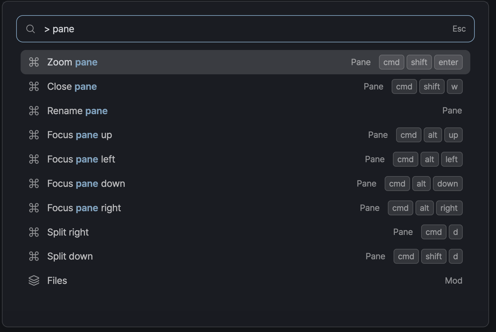

# Kommand

하나의 명령 팔레트. herdr TUI 플러그인 [herdr-bar](https://github.com/jeffarese/herdr-bar)(Jeff Arese, MIT)를 따라 herdr-app mod로 새로 만들었다. 탭·에이전트로 가기, 앱 명령, mod 열기와 mod가 내놓은 기능, `keys.json`에 묶인 동작, 레이아웃 전환까지 한 목록에서 퍼지 검색으로 찾는다. 첫 글자 `>` `@` `$` `!`로 범위를 좁히고, 비어 있으면 최근 → 장소 → mod → 명령 순으로 묶어 보여준다.

**What you see:**

- 창 위쪽(40px 아래) 가운데에 640px 폭, 창 높이 80%까지의 팝업. 배경은 테마의 `popover`, 안쪽 여백 18px.
- **검색 줄** 36px: 둥근 9px, accent 테두리, 왼쪽 돋보기, 입력(12.8px), 오른쪽 "Esc". 빈 입력의 안내: "Search…   > commands   @ agents   $ tabs   ! needs you".
- **목록**: 한 번에 10줄, 줄 높이 32px, 묶음 제목 26px(11px semibold, dim). 각 줄 = 맨 앞 아이콘(15px: 에이전트는 그 프로그램 아이콘, 탭은 터미널, mod는 겹친 판, 나머지는 ⌘) · 장소면 상태 점(테마의 상태 색) · 제목 · 입력 중이면 오른쪽에 묶음 이름 · 묶인 키가 있으면 키 칩(테두리 있는 작은 상자, `cmd` `shift` `p`처럼 나눠서).
- 선택한 줄은 `selected` 배경, hover는 `hover` 배경. 입력 중이면 제목에서 맞은 글자를 accent·semibold로.
- 맞는 게 없으면 `Nothing matches "<검색어>".`

**How it behaves:**

- **열기**: `mod.open:kommand`(이 패키지의 `keys.json`은 `cmd-k`). props `{ query }`를 주면 그 검색어를 채워 연다(예: `">"`).
- **항목**:
  - Go to: 스페이스의 탭마다 한 줄(`<스페이스> › <탭>`, 상태 점). 급한 것부터(응답 대기 → 완료 → 나머지), 지금 있는 탭은 맨 뒤(열고 Enter = 직전으로).
  - Agent: 에이전트마다 `<프로그램>: <제목>` → `agent.focus`.
  - Mod: 레이아웃 스택 안의 패널(예: Files, Changes)을 고르고 펼치거나, 보이는 중이면 접는다. `mods/*/mod.json`에 `overlay`가 있으면 "Open <title>", `palette` 항목은 그대로(`command`면 앱 명령, `props`면 그 props로 mod를 오버레이로).
  - 명령: 이름을 붙인 앱 명령(Tab, Pane, Space, Layout, Terminal, Agent, Window, App), 레이아웃마다 "Layout: <이름>", 테마들, 이름이 없는 새 명령은 `<verb> <noun>`으로. `keys.json`(전역과 지금 레이아웃 구역)에 묶인 동작 중 아직 없는 것.
- **범위**: `>` 장소가 아닌 것(명령·mod), `@` 에이전트, `$` 탭, `!` 응답 대기·완료인 장소.
- **빈 입력**: 최근 5개 → Go to → Mod → Tab → Pane → Space → Layout → Terminal → Agent → Window → App.
- **입력 중**: 퍼지 점수(맞은 글자마다 1, 낱말 첫 글자 +6, 이어지면 +3씩, 건너뛴 만큼 −0.3(최대 6), 긴 제목 −0.02/글자). 제목에서 맞으면 우선, 묶음·이름·검색어에서만 맞으면 −4. 동점이면 최근 순.
- **키**: Enter 실행, ↑/↓ 한 줄, PageUp/PageDown 10줄, Esc 닫기. 끝에서 넘어가지 않는다. 클릭도 실행. 휠로 스크롤하면 선택이 화면 안에 남게 따라간다.
- **최근**: 실행한 항목 20개를 `localStorage`의 `recent`에.
- 실행: `runs`가 있으면 차례로(패널 펼치기·접기), `open`이면 오버레이, `mod.clone`은 prompt 대화상자, `layout.clone`은 지금 레이아웃 이름으로, 그 밖은 `run(name, args)`.

**Built from:**

- mod 하나(`mods/kommand/main.js`, `mod.json`). `mod.json`: `{ "place": "none", "title": "Kommand", "overlay": { "kind": "popup", "at": "top", "offset": 40, "width": 640, "height": 0.8 } }`.
- `gpui-kit`의 `View`, `div`, `svg`, `image`, `gpui-base`의 `v_flex`, `h_flex`, `InputState`, `Input`, `fs/promises`(`mods/*/mod.json`을 읽는다).
- `herdr`: `commands`, `layouts`, `keys`, `run`, `theme`, `props`, `closeOverlay`, `openOverlay`, `shared`(지금 레이아웃 이름), `window`(플랫폼), `spaces`, `agents`, `appHome`, `layout`.
- 함께 주는 아이콘: `mods/workspace-chrome/{terminal,layers,search}.svg`, `frame/palette/command.svg`, 에이전트는 그 프로그램 아이콘.
- 프로그램을 실행하거나 네트워크를 쓰지 않는다. `~/.config/herdr-app/mods/*/mod.json`만 읽는다.

**Watch out:**

- 스크롤 목록은 줄을 쌓지 말고 모델의 위치(위·아래 끝)로 절대 배치한다. GPUI가 높이를 정수로 반올림해 40줄쯤 내려가면 19px(줌 1.3)씩 어긋나 선택 줄이 잘린다.
- macOS에서는 `window.*` 명령을 뺀다. 무엇을 가리켜야 하는 명령(`tab.select`, `pane.focus`, `layout.set` 등)과 필수 인자가 있는 명령은 목록에 두지 않는다.
- `"<mod>.<command>"` 키 동작은 보이는 mod 복사본에만 닿는다.
- 열리자마자 입력에 포커스를 주고, 600ms 뒤 한 번 더 준다(오버레이가 키보드를 늦게 넘길 때).

**Done when:**

- `herdr-app check ~/.config/herdr-app/mods/kommand`가 통과한다.
- `cmd-k`로 열면 최근·Go to·Mod·명령 묶음이 보이고, 입력하면 맞은 글자가 강조된 순위 목록이 된다.
- `>` 를 치면 장소가 빠지고, `@`는 에이전트만, `!`는 응답 대기·완료인 탭·에이전트만 남는다.
- Enter로 고른 항목이 실행되고 팝업이 닫히며, 다음에 열면 최근에 올라와 있다.
- 묶인 키가 있는 명령 옆에 그 키 칩이 보인다.
