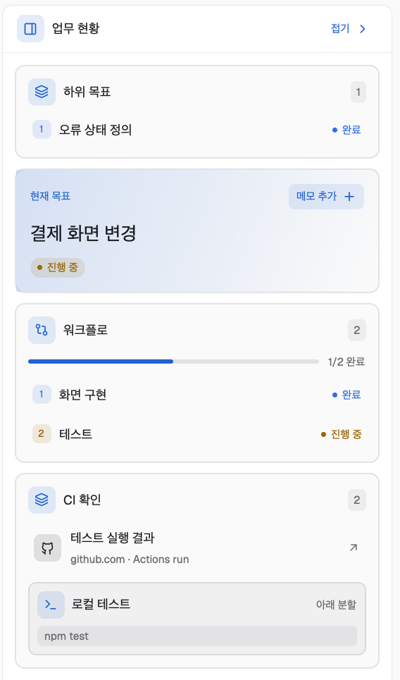

# Workboard

지금 보고 있는 Herdr 탭의 목표와 진행 상황을 오른쪽에서 확인한다. 원하는 스페이스에서는 탭들이 하나의 보드를 공유할 수 있다. 에이전트가 대화에서 필요한 정보만 골라 발행하고, 패널을 접으면 하단에 목표·상태·완료 단계 수·기한이 남는다.



**What you see:**

- 오른쪽 396px 패널(드래그 범위 280–700px). 상단에 `Workboard`와 `접기`, 아래에 스크롤 가능한 카드. 목표 카드는 테마 강조색과 큰 제목으로 현재 목표를 구분한다.
- 에이전트가 섹션 제목과 배치 순서, 항목별 표시 타입을 정한다. mod는 목표·목록·진행 섹션, 그리고 글머리표·번호 단계·링크·메모·커맨드의 모양과 동작을 제공한다. 하위 목표와 워크플로가 같은 번호 단계 스타일을 공유할 수 있다.
- 접힌 상태에서는 하단 오른쪽 360px 칸에 목표 제목·상태·기한, 첫 번째 비어 있지 않은 진행 섹션의 완료 수와 미니 진행 막대가 표시된다. 없는 항목은 숨긴다.

**How it behaves:**

- 하단 요약을 누르면 패널이 열리고, 패널에서 `접기`를 누르면 요약이 돌아온다. 팔레트의 `Workboard: 업무 패널 여닫기`도 같은 동작이다.
- 기본은 탭별 데이터다. 공유를 켠 스페이스에서는 탭을 전환하거나 같은 스페이스에서 새 탭을 열어도 같은 목표와 메모가 보인다. 발행된 목표가 없으면 에이전트에게 현재 업무 발행을 요청하라는 안내가 나온다.
- `메모 추가`를 누르면 현재 목표 바로 아래에 입력창이 열린다. 빈 메모는 저장할 수 없다. `삭제`는 내 메모를 지우거나 에이전트 메모를 패널에서 숨긴다. 에이전트가 새 현황을 발행해도 내 메모와 숨김은 같은 목표 ID에 남는다.
- 링크는 제목 아래에 호스트를 표시하고, GitHub·Slack·Jira·Confluence는 번들 아이콘을 쓴다. 다른 호스트는 지구본 아이콘을 쓴다. 외부 파비콘을 내려받지 않으며, 가리키면 전체 URL이 표시되고 누르면 시스템 브라우저에서 연다.
- 제안 커맨드는 실행 파일·인자와 분할 방향을 먼저 보여준다. 클릭하면 현재 탭에서 포커스한 터미널(없으면 탭의 첫 터미널)을 나누고 그 터미널의 작업 디렉터리에서 지정한 `argv`를 실행한다. 터미널이 없는 탭에서는 실행하지 않는다.

**Built from:**

1. `./install.sh workboard` 후 팔레트에서 **Workboard: 업무 레이아웃 열기**를 선택한다. CLI는 `herdr-app do layout.switch '{"name":"workboard"}'`. 기존 레이아웃을 덮어쓰지 않는다.
2. 사용하는 에이전트가 `~/.agents/skills`를 읽는다면 [에이전트 스킬](skills/herdr-workboard/SKILL.md)을 설치한다. 다른 스킬 위치를 쓰는 에이전트에는 해당 위치에 넣거나 문서를 직접 읽힌다.

   ```sh
   mkdir -p ~/.agents/skills/herdr-workboard
   cp workboard/skills/herdr-workboard/SKILL.md ~/.agents/skills/herdr-workboard/
   ```

3. 탭 안의 에이전트에게 **“지금 업무를 Herdr Workboard에 발행해 줘”**라고 요청한다. 자동 transcript 수집이나 별도 서비스는 없다. 에이전트가 [스냅숏 형식](skills/herdr-workboard/SKILL.md#snapshot-version-2)에 맞춰 섹션과 항목을 구성한다. 기존 v1 발행 파일도 그대로 표시한다.

   ```sh
   publisher="${HERDR_APP_HOME:-$HOME/.config/herdr-app}/mods/workboard/publish.mjs"
   node "$publisher" show
   node "$publisher" publish /path/to/snapshot.json  # 파일 대신 -로 표준 입력도 가능
   ```

- `main.js`는 Herdr의 `gpui-base` `Button`, `Link`, `Textarea`, `h_flex`, `v_flex`와 기본 아이콘을 재사용한다. 레이아웃에는 오른쪽 `workboard` 블록(`role: "panel"`)과 하단 `workboard-status` 블록(`role: "status"`)을 둔다. 기존 개인 레이아웃에 넣으려면 [동봉 레이아웃](layouts/workboard.json)의 두 블록을 같은 ID로 복사하고, 상태 칸은 기존 statusbar 블록과 `row`로 묶는다. 상태 칸 자체는 숨기지 않는다. 패널이 열린 동안엔 내용을 그리지 않아도 팔레트 명령을 받는다.
- `model.mjs`의 검증 규칙은 mod와 `publish.mjs`가 공유한다. CLI는 `herdr-app ls`의 터미널 주소와 `HC_TERMINAL_ID`를 대조해 에이전트가 속한 탭과 스페이스를 찾는다. 기본 탭 데이터는 Herdr 홈의 `data/workboard/<탭 ID>.snapshot.json`과 `.memos.json`에 저장한다. CLI는 발행 파일을 원자 교체하고, UI는 `writeTextFile`의 내용 비교로 메모 파일을 덮어쓸 때 충돌을 막는다.

## 스페이스 공유

1. `herdr-app ls`의 `spaces`에서 공유할 스페이스의 `id`를 확인한다. 같은 이름이라도 ID가 다르면 다른 스페이스다.
2. `${HERDR_APP_HOME:-$HOME/.config/herdr-app}/data/workboard/config.json`에 다음처럼 실제 ID를 넣는다. 디렉터리가 없으면 만들고, 파일이 이미 있으면 목록에 ID를 추가한다.

   ```json
   { "sharedSpaces": ["sp123"] }
   ```

3. 해당 스페이스의 에이전트에게 다시 발행을 요청한다. 평소처럼 `show`와 `publish`를 실행하면 스페이스를 자동으로 선택한다. 터미널 밖에서는 `show` 또는 `publish` 앞에 `--space SPACE_ID`를 쓴다. `--tab TAB_ID`는 공유 여부와 무관하게 탭 전용 파일에 접근한다.

공유 보드는 `data/workboard/spaces/` 아래에 별도 저장한다. 기존 탭 데이터는 이동하거나 병합하지 않는다. 목록에서 ID를 빼면 기존 탭별 보드로 돌아가며, 공유 파일도 그대로 남는다. 같은 스페이스에서 여러 에이전트가 발행하면 마지막 발행이 목표와 진행 상태를 갱신한다.

**Watch out:**

- 발행에는 Node.js 18 이상이 필요하다. SSH 등의 원격 에이전트는 Herdr 앱이 있는 컴퓨터에서 `--tab` 또는 공유 중인 `--space`를 지정해 발행한다.
- 현재 목표 ID와 메모 ID를 갱신마다 유지한다. 보드나 목표가 바뀌면 이전 메모를 현재 목표에 섞지 않는다. 같은 보드를 여러 에이전트가 갱신한다면 마지막으로 발행한 스냅숏을 표시한다.
- 링크는 HTTP(S)만 받는다. 커맨드는 암묵적으로 셸에 넘기지 않으며, 발행·새로고침·탭 전환으로는 실행되지 않는다.
- 이전 `work-overview`에서 업그레이드할 때는 Herdr 홈의 `data/work-overview`를 `data/workboard`로 옮기고, 개인 레이아웃의 블록 ID·mod 이름 및 단축키를 `workboard`로 바꾼다. 이미 `data/workboard`가 있으면 덮어쓰지 말고 탭별 파일을 확인해 병합한다.

**Done when:**

- 설치 후 `herdr-app check "${HERDR_APP_HOME:-$HOME/.config/herdr-app}/mods/workboard"`가 통과한다.
- `node workboard/check.mjs`가 v1 변환, v2 섹션·항목의 순서, 잘못된 조합 차단, 메모 ID 유지에 따른 숨김을 검증한다.
- 서로 다른 두 탭 중 하나에 발행하고 패널을 열고 접는다. 발행한 탭에만 카드와 요약이 나온다.
- 공유를 켠 스페이스에서 탭 두 개가 같은 목표와 메모를 표시하고, 다른 스페이스와 탭 전용 데이터는 영향을 받지 않는다.
- 내 메모를 저장하면 CLI `show`에도 보인다. 삭제하면 사라지고, 에이전트 메모를 숨긴 다음 다시 발행해도 그 메모는 돌아오지 않는다.
- 무해한 `pwd`를 제안해 실행한다. 탭 안에 새 터미널이 생기고 기존 터미널의 디렉터리가 출력된다.
